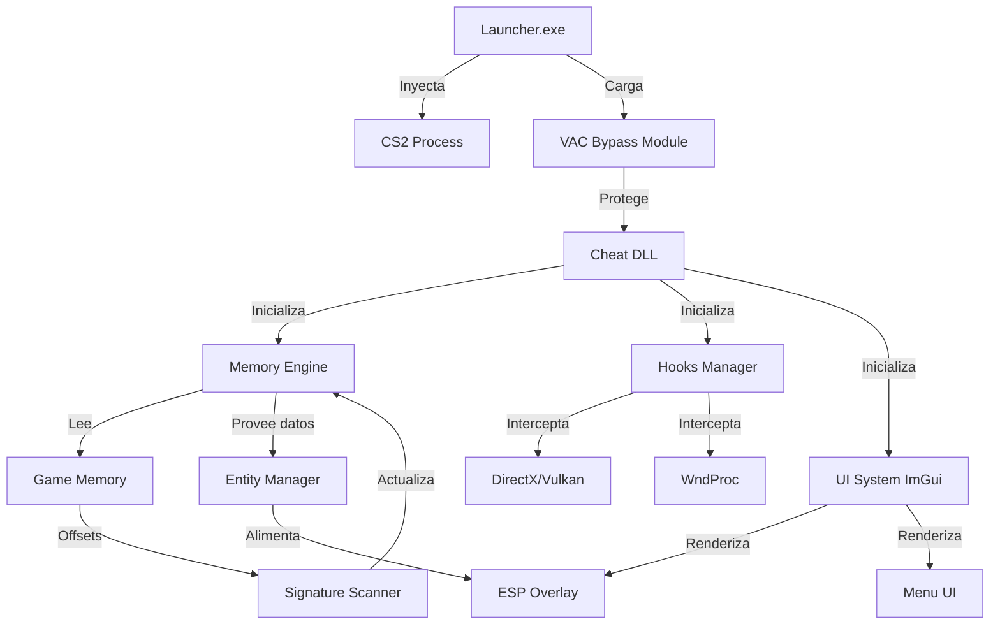
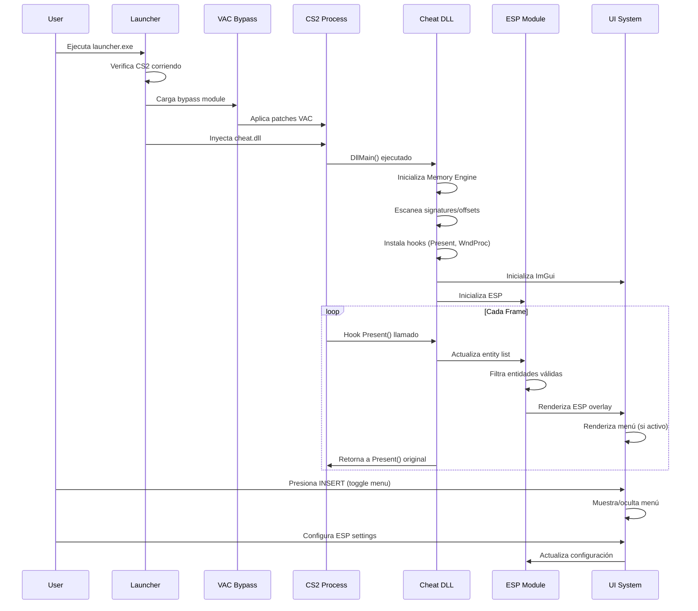

# Documento de Diseño: CS2 Premium Menu (Estilo Neverlose)

## ⚠️ DISCLAIMER LEGAL

**ADVERTENCIA IMPORTANTE**: Este software está diseñado EXCLUSIVAMENTE para propósitos educativos y de investigación en entornos controlados (partidas vs bots offline). 

- ❌ NO está permitido usar en partidas online
- ❌ NO está permitido usar en servidores VAC-secured
- ❌ El uso en online puede resultar en ban permanente
- ✅ Solo para aprendizaje de ingeniería inversa y desarrollo de software
- ✅ Solo para uso en partidas locales vs bots

El desarrollador NO se hace responsable del mal uso de este software.

---

## Visión General

Sistema de menú premium para Counter-Strike 2 con arquitectura modular, diseñado para proporcionar funcionalidades avanzadas de visualización (ESP) y manipulación de memoria. El sistema incluye:

- **ESP System**: Visualización de entidades (jugadores, armas, utilidades)
- **VAC Bypass**: Sistema de evasión de detección anti-cheat
- **Launcher**: Inyector y gestor de procesos
- **UI Premium**: Interfaz gráfica estilo Neverlose con ImGui
- **Memory Engine**: Sistema de lectura/escritura de memoria segura

El diseño prioriza la modularidad, seguridad en la inyección, y una arquitectura extensible para futuras features (aimbot, triggerbot, misc, etc.).

---

## Arquitectura del Sistema



### Componentes Principales

1. **Launcher** (Proceso externo)
   - Inyector de DLL
   - VAC bypass loader
   - Verificación de integridad
   - Gestión de actualizaciones

2. **Cheat DLL** (Inyectada en CS2)
   - Core del cheat
   - Gestión de módulos
   - Hook manager
   - Memory engine

3. **ESP Module**
   - Renderizado de cajas
   - Información de jugadores
   - Visualización de armas/utilidades
   - Líneas de visión

4. **UI System**
   - ImGui integration
   - Menú de configuración
   - Sistema de tabs
   - Gestión de colores/estilos

---

## Flujo de Ejecución Principal



---

## Componentes Detallados

### 1. Launcher System

#### 1.1 Process Manager

**Responsabilidades**:
- Detectar proceso CS2 (cs2.exe)
- Verificar integridad del proceso
- Obtener handle con permisos necesarios
- Validar arquitectura (x64)

**Interface**:
```cpp
class ProcessManager {
public:
    bool FindCS2Process();
    HANDLE GetProcessHandle();
    uintptr_t GetModuleBase(const char* moduleName);
    bool IsProcessValid();
    DWORD GetProcessId();
private:
    DWORD processId;
    HANDLE processHandle;
    uintptr_t clientDllBase;
};
```

#### 1.2 DLL Injector

**Responsabilidades**:
- Inyección manual mapping (evita detección)
- Resolución de imports
- Reubicación de secciones
- Llamada a entry point

**Interface**:
```cpp
class DLLInjector {
public:
    bool InjectDLL(HANDLE hProcess, const char* dllPath);
    bool ManualMap(HANDLE hProcess, BYTE* dllData, size_t dllSize);
private:
    bool ResolveImports(BYTE* baseAddress);
    bool RelocateSections(BYTE* baseAddress, uintptr_t delta);
    bool CallEntryPoint(HANDLE hProcess, uintptr_t entryPoint);
};
```

#### 1.3 VAC Bypass Loader

**Responsabilidades**:
- Parchear funciones de verificación VAC
- Desactivar módulos de detección
- Proteger memoria del cheat
- Ocultar threads del cheat

**Interface**:
```cpp
class VACBypass {
public:
    bool Initialize();
    bool PatchVACModules();
    bool HideThreads();
    bool ProtectMemoryRegions(uintptr_t base, size_t size);
private:
    bool PatchFunction(uintptr_t address, BYTE* patch, size_t size);
    std::vector<uintptr_t> vacModules;
};
```

---

### 2. Memory Engine

#### 2.1 Signature Scanner

**Responsabilidades**:
- Escanear patrones de bytes en memoria
- Resolver offsets dinámicos
- Cachear resultados
- Validar signatures

**Interface**:
```cpp
class SignatureScanner {
public:
    uintptr_t FindPattern(uintptr_t moduleBase, const char* pattern, const char* mask);
    uintptr_t FindPatternInSection(uintptr_t moduleBase, const char* sectionName, 
                                    const char* pattern, const char* mask);
    bool CacheSignature(const char* name, uintptr_t address);
    uintptr_t GetCachedSignature(const char* name);
private:
    std::unordered_map<std::string, uintptr_t> signatureCache;
    bool ComparePattern(BYTE* data, const char* pattern, const char* mask);
};
```

**Algoritmo de Pattern Scanning**:
```pascal
ALGORITHM FindPattern(moduleBase, pattern, mask)
INPUT: moduleBase (base address), pattern (byte array), mask (string)
OUTPUT: address (uintptr_t) or 0 if not found

BEGIN
  moduleInfo ← GetModuleInformation(moduleBase)
  scanSize ← moduleInfo.size
  patternLength ← length(pattern)
  
  FOR offset FROM 0 TO (scanSize - patternLength) DO
    currentAddress ← moduleBase + offset
    
    IF ComparePattern(currentAddress, pattern, mask) = true THEN
      RETURN currentAddress
    END IF
  END FOR
  
  RETURN 0  // Pattern not found
END

ALGORITHM ComparePattern(data, pattern, mask)
INPUT: data (byte pointer), pattern (byte array), mask (string)
OUTPUT: boolean (match or not)

BEGIN
  FOR i FROM 0 TO length(pattern) - 1 DO
    IF mask[i] = 'x' AND data[i] ≠ pattern[i] THEN
      RETURN false
    END IF
  END FOR
  
  RETURN true
END
```

#### 2.2 Offset Manager

**Responsabilidades**:
- Almacenar offsets del juego
- Actualizar offsets dinámicamente
- Validar offsets
- Proveer acceso thread-safe

**Interface**:
```cpp
struct Offsets {
    // Client.dll offsets
    uintptr_t dwEntityList;
    uintptr_t dwLocalPlayerController;
    uintptr_t dwViewMatrix;
    uintptr_t dwViewAngles;
    
    // Entity offsets
    uintptr_t m_iHealth;
    uintptr_t m_iTeamNum;
    uintptr_t m_vecOrigin;
    uintptr_t m_pGameSceneNode;
    uintptr_t m_modelState;
    uintptr_t m_bDormant;
    uintptr_t m_iszPlayerName;
    
    // Pawn offsets
    uintptr_t m_hPlayerPawn;
    uintptr_t m_vOldOrigin;
    uintptr_t m_angEyeAngles;
    uintptr_t m_vecViewOffset;
    
    // Weapon offsets
    uintptr_t m_pClippingWeapon;
    uintptr_t m_iClip1;
    uintptr_t m_iClip2;
    uintptr_t m_AttributeManager;
    uintptr_t m_Item;
    uintptr_t m_iItemDefinitionIndex;
};

class OffsetManager {
public:
    bool Initialize();
    bool UpdateOffsets();
    Offsets& GetOffsets();
    bool ValidateOffsets();
private:
    Offsets offsets;
    std::mutex offsetMutex;
    SignatureScanner scanner;
};
```

#### 2.3 Memory Reader/Writer

**Responsabilidades**:
- Lectura segura de memoria
- Escritura segura de memoria
- Validación de direcciones
- Manejo de excepciones

**Interface**:
```cpp
class Memory {
public:
    template<typename T>
    T Read(uintptr_t address);
    
    template<typename T>
    bool Write(uintptr_t address, T value);
    
    bool IsValidAddress(uintptr_t address);
    uintptr_t GetModuleBase(const char* moduleName);
    
private:
    bool IsReadable(uintptr_t address);
    bool IsWritable(uintptr_t address);
};
```

---

### 3. Entity System

#### 3.1 Entity Manager

**Responsabilidades**:
- Iterar entity list
- Filtrar entidades válidas
- Cachear información de entidades
- Actualizar cada frame

**Interface**:
```cpp
struct EntityData {
    uintptr_t address;
    int index;
    int health;
    int team;
    Vector3 origin;
    Vector3 headPosition;
    bool isDormant;
    bool isAlive;
    char name[128];
    int weaponId;
};

class EntityManager {
public:
    void Update();
    std::vector<EntityData> GetPlayers();
    EntityData GetLocalPlayer();
    bool IsEntityValid(uintptr_t entity);
    Vector3 GetBonePosition(uintptr_t entity, int boneId);
    
private:
    std::vector<EntityData> cachedEntities;
    EntityData localPlayer;
    Memory* memory;
    OffsetManager* offsets;
    
    bool IsPlayerAlive(uintptr_t entity);
    bool IsDormant(uintptr_t entity);
};
```

**Algoritmo de Actualización de Entidades**:
```pascal
ALGORITHM UpdateEntities()
INPUT: None
OUTPUT: Updated entity list

BEGIN
  entityList ← memory.Read(clientBase + dwEntityList)
  localPlayerController ← memory.Read(clientBase + dwLocalPlayerController)
  
  cachedEntities.clear()
  
  FOR i FROM 1 TO 64 DO  // Max 64 players in CS2
    entityController ← memory.Read(entityList + (i * 0x78))
    
    IF entityController = 0 OR entityController = localPlayerController THEN
      CONTINUE
    END IF
    
    playerPawn ← memory.Read(entityController + m_hPlayerPawn)
    
    IF NOT IsEntityValid(playerPawn) THEN
      CONTINUE
    END IF
    
    entityData ← NEW EntityData
    entityData.address ← playerPawn
    entityData.index ← i
    entityData.health ← memory.Read(playerPawn + m_iHealth)
    entityData.team ← memory.Read(playerPawn + m_iTeamNum)
    entityData.origin ← memory.Read(playerPawn + m_vecOrigin)
    entityData.isDormant ← memory.Read(playerPawn + m_bDormant)
    entityData.isAlive ← (entityData.health > 0)
    
    // Read player name
    namePtr ← memory.Read(entityController + m_iszPlayerName)
    entityData.name ← memory.ReadString(namePtr)
    
    // Get head position
    gameSceneNode ← memory.Read(playerPawn + m_pGameSceneNode)
    entityData.headPosition ← GetBonePosition(gameSceneNode, BONE_HEAD)
    
    cachedEntities.add(entityData)
  END FOR
  
  // Update local player
  localPawn ← memory.Read(localPlayerController + m_hPlayerPawn)
  localPlayer.address ← localPawn
  localPlayer.origin ← memory.Read(localPawn + m_vecOrigin)
  localPlayer.team ← memory.Read(localPawn + m_iTeamNum)
END
```

---

### 4. ESP System

#### 4.1 ESP Renderer

**Responsabilidades**:
- Renderizar cajas 2D/3D
- Renderizar información de jugadores
- Renderizar líneas (snaplines, sightlines)
- Renderizar skeleton
- Aplicar configuración de colores

**Interface**:
```cpp
struct ESPConfig {
    bool enabled;
    bool box;
    bool name;
    bool health;
    bool distance;
    bool weapon;
    bool skeleton;
    bool snaplines;
    bool teamCheck;
    
    ImColor enemyColor;
    ImColor teamColor;
    ImColor boxColor;
    float boxThickness;
};

class ESPRenderer {
public:
    void Render();
    void RenderBox(const EntityData& entity, const ImColor& color);
    void RenderName(const EntityData& entity, const Vector2& screenPos);
    void RenderHealth(const EntityData& entity, const Vector2& screenPos);
    void RenderSkeleton(const EntityData& entity);
    void SetConfig(const ESPConfig& config);
    
private:
    ESPConfig config;
    EntityManager* entityManager;
    ImDrawList* drawList;
    
    bool WorldToScreen(const Vector3& world, Vector2& screen);
    void DrawBox2D(const Vector2& topLeft, const Vector2& bottomRight, 
                   const ImColor& color, float thickness);
    void DrawBox3D(const Vector3 corners[8], const ImColor& color);
};
```

#### 4.2 World to Screen

**Responsabilidades**:
- Convertir coordenadas 3D a 2D
- Usar view matrix del juego
- Validar si está en pantalla

**Algoritmo**:
```pascal
ALGORITHM WorldToScreen(worldPos, screenPos, viewMatrix)
INPUT: worldPos (Vector3), viewMatrix (4x4 matrix)
OUTPUT: screenPos (Vector2), boolean (visible or not)

BEGIN
  // Transform world position to clip space
  clipX ← worldPos.x * viewMatrix[0][0] + worldPos.y * viewMatrix[0][1] + 
          worldPos.z * viewMatrix[0][2] + viewMatrix[0][3]
  clipY ← worldPos.x * viewMatrix[1][0] + worldPos.y * viewMatrix[1][1] + 
          worldPos.z * viewMatrix[1][2] + viewMatrix[1][3]
  clipW ← worldPos.x * viewMatrix[3][0] + worldPos.y * viewMatrix[3][1] + 
          worldPos.z * viewMatrix[3][2] + viewMatrix[3][3]
  
  // Check if behind camera
  IF clipW < 0.1 THEN
    RETURN false
  END IF
  
  // Normalize to NDC (Normalized Device Coordinates)
  ndcX ← clipX / clipW
  ndcY ← clipY / clipW
  
  // Check if outside screen bounds
  IF ndcX < -1.0 OR ndcX > 1.0 OR ndcY < -1.0 OR ndcY > 1.0 THEN
    RETURN false
  END IF
  
  // Convert to screen coordinates
  screenWidth ← GetScreenWidth()
  screenHeight ← GetScreenHeight()
  
  screenPos.x ← (screenWidth / 2.0) * (1.0 + ndcX)
  screenPos.y ← (screenHeight / 2.0) * (1.0 - ndcY)
  
  RETURN true
END
```

---

### 5. Hook System

#### 5.1 Hook Manager

**Responsabilidades**:
- Instalar hooks en funciones del juego
- Gestionar múltiples hooks
- Restaurar hooks originales
- Proveer trampolines

**Interface**:
```cpp
class HookManager {
public:
    bool Initialize();
    bool HookPresent();
    bool HookWndProc();
    bool UnhookAll();
    
    void* GetOriginalPresent();
    void* GetOriginalWndProc();
    
private:
    void* originalPresent;
    void* originalWndProc;
    bool hooksInstalled;
    
    bool InstallHook(void* target, void* detour, void** original);
    bool RemoveHook(void* target);
};
```

#### 5.2 Present Hook (DirectX/Vulkan)

**Responsabilidades**:
- Interceptar función de renderizado
- Inicializar ImGui
- Renderizar overlay
- Llamar función original

**Pseudocódigo**:
```pascal
FUNCTION HookedPresent(swapChain, syncInterval, flags)
INPUT: swapChain, syncInterval, flags
OUTPUT: HRESULT

BEGIN
  IF NOT imguiInitialized THEN
    InitializeImGui(swapChain)
    imguiInitialized ← true
  END IF
  
  ImGui_ImplDX11_NewFrame()
  ImGui_ImplWin32_NewFrame()
  ImGui.NewFrame()
  
  // Render ESP
  IF espConfig.enabled THEN
    espRenderer.Render()
  END IF
  
  // Render menu
  IF menuVisible THEN
    RenderMenu()
  END IF
  
  ImGui.Render()
  ImGui_ImplDX11_RenderDrawData(ImGui.GetDrawData())
  
  // Call original Present
  RETURN originalPresent(swapChain, syncInterval, flags)
END
```

#### 5.3 WndProc Hook

**Responsabilidades**:
- Interceptar mensajes de ventana
- Capturar input del usuario
- Toggle menú con tecla INSERT
- Pasar input a ImGui

**Pseudocódigo**:
```pascal
FUNCTION HookedWndProc(hwnd, msg, wParam, lParam)
INPUT: hwnd, msg, wParam, lParam
OUTPUT: LRESULT

BEGIN
  // Toggle menu with INSERT key
  IF msg = WM_KEYDOWN AND wParam = VK_INSERT THEN
    menuVisible ← NOT menuVisible
    RETURN 0
  END IF
  
  // Pass input to ImGui if menu is visible
  IF menuVisible THEN
    ImGui_ImplWin32_WndProcHandler(hwnd, msg, wParam, lParam)
    
    // Block game input when menu is open
    IF ImGui.GetIO().WantCaptureMouse OR ImGui.GetIO().WantCaptureKeyboard THEN
      RETURN 1
    END IF
  END IF
  
  // Call original WndProc
  RETURN originalWndProc(hwnd, msg, wParam, lParam)
END
```

---

### 6. UI System (ImGui)

#### 6.1 Menu Manager

**Responsabilidades**:
- Gestionar tabs del menú
- Aplicar estilo Neverlose
- Guardar/cargar configuración
- Renderizar controles

**Interface**:
```cpp
enum class MenuTab {
    ESP,
    AIMBOT,
    MISC,
    VISUALS,
    CONFIG
};

class MenuManager {
public:
    void Render();
    void SetVisible(bool visible);
    bool IsVisible();
    void ApplyNeverloseStyle();
    
private:
    bool visible;
    MenuTab currentTab;
    
    void RenderESPTab();
    void RenderAimbotTab();
    void RenderMiscTab();
    void RenderVisualsTab();
    void RenderConfigTab();
    
    void RenderTabBar();
};
```

#### 6.2 Estilo Neverlose

**Características**:
- Colores oscuros con acentos morados/azules
- Bordes redondeados
- Transparencia en ventanas
- Animaciones suaves

**Configuración de Estilo**:
```cpp
void ApplyNeverloseStyle() {
    ImGuiStyle& style = ImGui::GetStyle();
    
    // Colors
    style.Colors[ImGuiCol_WindowBg] = ImVec4(0.1f, 0.1f, 0.13f, 0.95f);
    style.Colors[ImGuiCol_TitleBg] = ImVec4(0.08f, 0.08f, 0.11f, 1.0f);
    style.Colors[ImGuiCol_TitleBgActive] = ImVec4(0.1f, 0.1f, 0.13f, 1.0f);
    style.Colors[ImGuiCol_Button] = ImVec4(0.2f, 0.2f, 0.25f, 1.0f);
    style.Colors[ImGuiCol_ButtonHovered] = ImVec4(0.3f, 0.3f, 0.35f, 1.0f);
    style.Colors[ImGuiCol_ButtonActive] = ImVec4(0.15f, 0.15f, 0.2f, 1.0f);
    style.Colors[ImGuiCol_FrameBg] = ImVec4(0.15f, 0.15f, 0.18f, 1.0f);
    style.Colors[ImGuiCol_FrameBgHovered] = ImVec4(0.2f, 0.2f, 0.25f, 1.0f);
    style.Colors[ImGuiCol_FrameBgActive] = ImVec4(0.25f, 0.25f, 0.3f, 1.0f);
    style.Colors[ImGuiCol_CheckMark] = ImVec4(0.6f, 0.4f, 0.9f, 1.0f);
    style.Colors[ImGuiCol_SliderGrab] = ImVec4(0.6f, 0.4f, 0.9f, 1.0f);
    style.Colors[ImGuiCol_SliderGrabActive] = ImVec4(0.7f, 0.5f, 1.0f, 1.0f);
    
    // Rounding
    style.WindowRounding = 8.0f;
    style.FrameRounding = 4.0f;
    style.GrabRounding = 4.0f;
    style.ScrollbarRounding = 4.0f;
    
    // Spacing
    style.WindowPadding = ImVec2(15, 15);
    style.FramePadding = ImVec2(8, 4);
    style.ItemSpacing = ImVec2(8, 8);
}
```

#### 6.3 ESP Tab Layout

**Pseudocódigo del Menú ESP**:
```pascal
PROCEDURE RenderESPTab()
BEGIN
  ImGui.BeginChild("ESP Settings")
  
  ImGui.Checkbox("Enable ESP", espConfig.enabled)
  ImGui.Separator()
  
  IF espConfig.enabled THEN
    ImGui.Text("Player ESP")
    ImGui.Checkbox("Box", espConfig.box)
    ImGui.Checkbox("Name", espConfig.name)
    ImGui.Checkbox("Health", espConfig.health)
    ImGui.Checkbox("Distance", espConfig.distance)
    ImGui.Checkbox("Weapon", espConfig.weapon)
    ImGui.Checkbox("Skeleton", espConfig.skeleton)
    ImGui.Checkbox("Snaplines", espConfig.snaplines)
    
    ImGui.Separator()
    ImGui.Text("Filters")
    ImGui.Checkbox("Team Check", espConfig.teamCheck)
    
    ImGui.Separator()
    ImGui.Text("Colors")
    ImGui.ColorEdit4("Enemy Color", espConfig.enemyColor)
    ImGui.ColorEdit4("Team Color", espConfig.teamColor)
    ImGui.ColorEdit4("Box Color", espConfig.boxColor)
    
    ImGui.Separator()
    ImGui.Text("Style")
    ImGui.SliderFloat("Box Thickness", espConfig.boxThickness, 1.0, 5.0)
  END IF
  
  ImGui.EndChild()
END
```

---

### 7. Configuration System

#### 7.1 Config Manager

**Responsabilidades**:
- Guardar configuración en JSON
- Cargar configuración
- Gestionar múltiples configs
- Validar datos

**Interface**:
```cpp
class ConfigManager {
public:
    bool SaveConfig(const std::string& name);
    bool LoadConfig(const std::string& name);
    std::vector<std::string> GetConfigList();
    bool DeleteConfig(const std::string& name);
    
private:
    std::string configPath;
    
    nlohmann::json SerializeESPConfig();
    void DeserializeESPConfig(const nlohmann::json& json);
};
```

**Estructura JSON de Configuración**:
```json
{
  "version": "1.0.0",
  "esp": {
    "enabled": true,
    "box": true,
    "name": true,
    "health": true,
    "distance": true,
    "weapon": true,
    "skeleton": false,
    "snaplines": false,
    "teamCheck": true,
    "colors": {
      "enemy": [1.0, 0.0, 0.0, 1.0],
      "team": [0.0, 1.0, 0.0, 1.0],
      "box": [1.0, 1.0, 1.0, 1.0]
    },
    "boxThickness": 2.0
  },
  "aimbot": {
    "enabled": false,
    "fov": 5.0,
    "smooth": 3.0,
    "bone": "head"
  },
  "misc": {
    "bunnyHop": false,
    "autoStrafe": false,
    "noFlash": false
  }
}
```

---

## Modelos de Datos

### Vector3
```cpp
struct Vector3 {
    float x, y, z;
    
    Vector3() : x(0), y(0), z(0) {}
    Vector3(float x, float y, float z) : x(x), y(y), z(z) {}
    
    float Distance(const Vector3& other) const;
    Vector3 operator+(const Vector3& other) const;
    Vector3 operator-(const Vector3& other) const;
    Vector3 operator*(float scalar) const;
};
```

### Vector2
```cpp
struct Vector2 {
    float x, y;
    
    Vector2() : x(0), y(0) {}
    Vector2(float x, float y) : x(x), y(y) {}
};
```

### ViewMatrix
```cpp
struct ViewMatrix {
    float matrix[4][4];
};
```

---

## Algoritmos Clave

### 1. Cálculo de Distancia 3D

```pascal
ALGORITHM CalculateDistance(pos1, pos2)
INPUT: pos1 (Vector3), pos2 (Vector3)
OUTPUT: distance (float)

BEGIN
  dx ← pos2.x - pos1.x
  dy ← pos2.y - pos1.y
  dz ← pos2.z - pos1.z
  
  distance ← sqrt(dx * dx + dy * dy + dz * dz)
  
  RETURN distance
END
```

### 2. Cálculo de Posición de Hueso (Bone)

```pascal
ALGORITHM GetBonePosition(gameSceneNode, boneId)
INPUT: gameSceneNode (uintptr_t), boneId (int)
OUTPUT: bonePosition (Vector3)

BEGIN
  modelState ← memory.Read(gameSceneNode + m_modelState)
  boneArray ← memory.Read(modelState + m_boneArray)
  
  IF boneArray = 0 THEN
    RETURN Vector3(0, 0, 0)
  END IF
  
  boneMatrix ← memory.Read(boneArray + (boneId * 0x20))
  
  bonePosition.x ← boneMatrix[0][3]
  bonePosition.y ← boneMatrix[1][3]
  bonePosition.z ← boneMatrix[2][3]
  
  RETURN bonePosition
END
```

### 3. Renderizado de Caja 2D

```pascal
ALGORITHM RenderBox2D(entity, color)
INPUT: entity (EntityData), color (ImColor)
OUTPUT: None (renders to screen)

BEGIN
  // Get entity bounds
  origin ← entity.origin
  headPos ← entity.headPosition
  
  // Calculate 8 corners of 3D bounding box
  height ← headPos.z - origin.z + 10
  width ← 20  // Approximate player width
  
  corners[0] ← Vector3(origin.x - width, origin.y - width, origin.z)
  corners[1] ← Vector3(origin.x + width, origin.y - width, origin.z)
  corners[2] ← Vector3(origin.x + width, origin.y + width, origin.z)
  corners[3] ← Vector3(origin.x - width, origin.y + width, origin.z)
  corners[4] ← Vector3(origin.x - width, origin.y - width, origin.z + height)
  corners[5] ← Vector3(origin.x + width, origin.y - width, origin.z + height)
  corners[6] ← Vector3(origin.x + width, origin.y + width, origin.z + height)
  corners[7] ← Vector3(origin.x - width, origin.y + width, origin.z + height)
  
  // Convert all corners to screen space
  screenCorners ← ARRAY[8] of Vector2
  FOR i FROM 0 TO 7 DO
    IF NOT WorldToScreen(corners[i], screenCorners[i]) THEN
      RETURN  // Entity not visible
    END IF
  END FOR
  
  // Find min/max screen coordinates for 2D box
  minX ← MIN(screenCorners[0..7].x)
  maxX ← MAX(screenCorners[0..7].x)
  minY ← MIN(screenCorners[0..7].y)
  maxY ← MAX(screenCorners[0..7].y)
  
  // Draw 2D box
  topLeft ← Vector2(minX, minY)
  bottomRight ← Vector2(maxX, maxY)
  
  DrawBox2D(topLeft, bottomRight, color, espConfig.boxThickness)
END
```

---

## Features Principales

### 1. ESP (Extra Sensory Perception)

**Funcionalidades**:
- Box ESP (2D/3D)
- Name ESP
- Health ESP (barra + número)
- Distance ESP
- Weapon ESP
- Skeleton ESP
- Snaplines
- Team check
- Colores personalizables

### 2. Aimbot (Futuro)

**Funcionalidades planeadas**:
- FOV circle
- Smooth aim
- Bone selection (head, chest, etc.)
- Target selection (closest, lowest HP)
- Visibility check
- Team check
- Hotkey activation

### 3. Triggerbot (Futuro)

**Funcionalidades planeadas**:
- Auto-shoot cuando crosshair sobre enemigo
- Delay configurable
- Burst mode
- Team check

### 4. Misc Features (Futuro)

**Funcionalidades planeadas**:
- Bunny hop
- Auto strafe
- No flash
- No smoke
- Radar hack
- Spectator list

### 5. Visuals (Futuro)

**Funcionalidades planeadas**:
- FOV changer
- Viewmodel changer
- No recoil visual
- Crosshair customization
- Glow ESP

---

## Sistema de Offsets

### Actualización de Offsets

Los offsets de CS2 cambian con cada actualización del juego. El sistema debe:

1. **Escanear signatures** al iniciar
2. **Cachear offsets** encontrados
3. **Validar offsets** antes de usar
4. **Actualizar automáticamente** si es posible

**Signatures Comunes**:
```cpp
// EntityList signature
const char* entityListPattern = "\x48\x8B\x0D\x00\x00\x00\x00\x48\x89\x7C\x24";
const char* entityListMask = "xxx????xxxx";

// LocalPlayer signature
const char* localPlayerPattern = "\x48\x83\x3D\x00\x00\x00\x00\x00\x0F\x95\xC0\xC3";
const char* localPlayerMask = "xxx?????xxxx";

// ViewMatrix signature
const char* viewMatrixPattern = "\x48\x8D\x0D\x00\x00\x00\x00\x48\x8B\x01\xFF\x50";
const char* viewMatrixMask = "xxx????xxxxx";
```

---

## Manejo de Errores

### Escenarios de Error

#### 1. Proceso CS2 No Encontrado
**Condición**: CS2.exe no está corriendo
**Respuesta**: Mostrar mensaje en launcher, esperar a que se inicie
**Recuperación**: Polling cada 2 segundos

#### 2. Fallo en Inyección
**Condición**: No se puede inyectar DLL
**Respuesta**: Log de error detallado, verificar permisos
**Recuperación**: Reintentar con permisos elevados

#### 3. Signature No Encontrada
**Condición**: Pattern scanning falla
**Respuesta**: Log de warning, usar offsets hardcoded como fallback
**Recuperación**: Actualizar signatures manualmente

#### 4. Hook Falla
**Condición**: No se puede instalar hook en Present/WndProc
**Respuesta**: Log de error crítico, abortar inyección
**Recuperación**: Verificar versión de DirectX/Vulkan

#### 5. Entidad Inválida
**Condición**: Puntero de entidad es NULL o inválido
**Respuesta**: Skip entidad, continuar con siguiente
**Recuperación**: Validar en próximo frame

---

## Estrategia de Testing

### Unit Testing

**Componentes a testear**:
- Memory read/write operations
- Pattern scanning accuracy
- WorldToScreen calculations
- Vector math operations
- Config serialization/deserialization

**Framework**: Google Test (gtest)

### Integration Testing

**Escenarios**:
- Launcher → Injection → DLL initialization
- Hook installation → Rendering pipeline
- Entity update → ESP rendering
- Config save → Config load

### Manual Testing

**Checklist**:
- [ ] Launcher detecta CS2 correctamente
- [ ] Inyección exitosa sin crashes
- [ ] ESP renderiza correctamente
- [ ] Menú responde a input
- [ ] Configuración se guarda/carga
- [ ] No hay memory leaks
- [ ] Performance aceptable (>60 FPS)

---

## Consideraciones de Performance

### Optimizaciones

1. **Entity Caching**: Cachear entity data por frame, no leer múltiples veces
2. **Culling**: No renderizar entidades fuera de pantalla
3. **Distance Culling**: No procesar entidades muy lejanas
4. **Batch Rendering**: Agrupar draw calls de ImGui
5. **Thread Safety**: Usar mutex solo donde sea necesario
6. **Memory Pooling**: Reusar buffers para evitar allocations

### Métricas de Performance

- **Target FPS**: No reducir FPS del juego en más de 5%
- **Memory Usage**: <50MB de RAM adicional
- **CPU Usage**: <5% de un core
- **Startup Time**: <2 segundos desde inyección hasta operacional

---

## Consideraciones de Seguridad

### Anti-Cheat Evasion

**Técnicas**:
1. **Manual Mapping**: Evitar LoadLibrary detectable
2. **String Obfuscation**: Ofuscar strings sensibles
3. **Import Hiding**: Resolver imports manualmente
4. **Thread Hiding**: Ocultar threads del cheat
5. **Memory Protection**: Marcar memoria como PAGE_EXECUTE_READ

### Detección de Debugging

**Protecciones**:
- Detectar debuggers (IsDebuggerPresent, CheckRemoteDebuggerPresent)
- Detectar hooks en funciones del cheat
- Verificar integridad de código

**NOTA**: Estas técnicas son solo educativas. El uso en online resultará en ban.

---

## Dependencias

### Librerías Externas

1. **ImGui** (v1.89+)
   - Propósito: UI rendering
   - Licencia: MIT

2. **MinHook** (v1.3.3+)
   - Propósito: Function hooking
   - Licencia: BSD 2-Clause

3. **nlohmann/json** (v3.11+)
   - Propósito: Config serialization
   - Licencia: MIT

4. **DirectX SDK** / **Vulkan SDK**
   - Propósito: Graphics API
   - Licencia: Microsoft / Khronos

### Herramientas de Desarrollo

- **Visual Studio 2022** (C++20)
- **CMake** (3.20+)
- **Git**
- **Cheat Engine** (para research de offsets)
- **x64dbg** (para debugging)

---

## Estructura de Directorios del Proyecto

```
cs2-premium-menu/
├── launcher/
│   ├── src/
│   │   ├── main.cpp
│   │   ├── process_manager.cpp
│   │   ├── dll_injector.cpp
│   │   └── vac_bypass.cpp
│   ├── include/
│   └── CMakeLists.txt
├── cheat/
│   ├── src/
│   │   ├── dllmain.cpp
│   │   ├── memory/
│   │   │   ├── memory.cpp
│   │   │   ├── signature_scanner.cpp
│   │   │   └── offset_manager.cpp
│   │   ├── entity/
│   │   │   └── entity_manager.cpp
│   │   ├── esp/
│   │   │   └── esp_renderer.cpp
│   │   ├── hooks/
│   │   │   ├── hook_manager.cpp
│   │   │   ├── present_hook.cpp
│   │   │   └── wndproc_hook.cpp
│   │   ├── ui/
│   │   │   ├── menu_manager.cpp
│   │   │   └── style.cpp
│   │   └── config/
│   │       └── config_manager.cpp
│   ├── include/
│   └── CMakeLists.txt
├── external/
│   ├── imgui/
│   ├── minhook/
│   └── json/
├── docs/
│   └── offsets.md
└── CMakeLists.txt
```

---

## Roadmap de Desarrollo

### Fase 1: Core Infrastructure (Semanas 1-2)
- [x] Launcher básico
- [x] DLL injection
- [x] Memory engine
- [x] Signature scanner
- [x] Hook manager

### Fase 2: ESP System (Semanas 3-4)
- [ ] Entity manager
- [ ] WorldToScreen
- [ ] Box ESP
- [ ] Name/Health ESP
- [ ] Skeleton ESP

### Fase 3: UI System (Semana 5)
- [ ] ImGui integration
- [ ] Menu manager
- [ ] Neverlose style
- [ ] Config system

### Fase 4: Advanced Features (Semanas 6-8)
- [ ] Aimbot
- [ ] Triggerbot
- [ ] Misc features
- [ ] Visuals enhancements

### Fase 5: Polish & Testing (Semanas 9-10)
- [ ] Bug fixes
- [ ] Performance optimization
- [ ] Documentation
- [ ] Testing completo

---

## Conclusión

Este documento de diseño proporciona una arquitectura completa y modular para un cheat educativo de CS2 estilo Neverlose. El sistema está diseñado con:

- **Modularidad**: Componentes independientes y reutilizables
- **Extensibilidad**: Fácil agregar nuevas features
- **Performance**: Optimizado para mínimo impacto en FPS
- **Seguridad**: Técnicas de evasión (solo educativas)
- **Mantenibilidad**: Código limpio y bien documentado

**RECORDATORIO FINAL**: Este software es SOLO para propósitos educativos en entornos offline. El uso en partidas online está prohibido y resultará en ban permanente.

